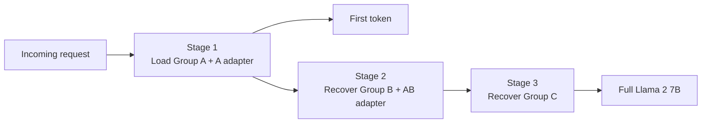

# ProgressiveServe

Progressive model loading and recovery for reducing cold-start latency in serverless LLM serving.

[Paper (PDF)](paper/progressive-serve-ksc-2025.pdf) · [Architecture notes](docs/ARCHITECTURE.md) · [한국어 요약](docs/README.ko.md) · [Reported results](results/README.md)

## Problem

Loading every parameter of a large language model before serving the first request makes serverless inference slow. ProgressiveServe reduces the user-visible delay by serving a smaller, pruned model first and recovering the full model in the background.

## Design

The system divides the 32 layers of Llama 2 7B into three groups:

- **Group A:** layers 1-20 and 29-32, served first with an A-specific LoRA adapter.
- **Group B:** layers 21-24, loaded next with an AB-specific LoRA adapter.
- **Group C:** layers 25-28, loaded last to restore the original model.



PassLayer placeholders preserve the model structure while missing layers are fetched and loaded. Stage-specific LoRA adapters compensate for quality loss until all layers are restored.

## Reported results

The paper evaluates Llama 2 7B on an NVIDIA RTX 5090 with model weights stored on an NFS server connected over 16 Gbps Ethernet. TriviaQA validation samples are evaluated with zero-shot greedy decoding.

| System | Stage | EM (%) | F1 (%) | Stage time (s) | TTFT (s) |
|---|---:|---:|---:|---:|---:|
| ServerlessLLM | Baseline | 55.67 | 66.11 | 114 | 114 |
| ProgressiveServe | 1 | 48.22 | 54.26 | 90 | 90 |
| ProgressiveServe | 2 | 56.22 | 62.02 | 19 | - |
| ProgressiveServe | 3 | 55.67 | 66.11 | 19 | - |

ProgressiveServe reduces time to first token from 114 seconds to 90 seconds, a **21.1% reduction**, and reaches the baseline EM and F1 scores after full recovery. The complete three-stage recovery takes 128 seconds; the extra recovery work happens after the first response.

## Repository scope

This repository is a publication companion for the KSC 2025 paper. It contains only material that can be traced directly to the publication:

```text
.
├── docs/                  # Architecture notes and Korean summary
├── paper/                 # Published paper
├── results/               # Table 1 values in machine-readable form
├── CITATION.cff
└── README.md
```

This repository is not presented as an end-to-end reproduction package: the original Ray Serve implementation, checkpoints, stage-specific LoRA adapters, and per-trial logs are not included. Runtime experiments that do not correspond to the published evaluation are deliberately excluded.

## Publication

**ProgressiveServe: Progressive Model Loading and Recovery for Mitigating Cold Start in Serverless LLM Serving**  
Nadam Park, Nakyeong Lee, Juwon Lee, and Jaehyeong Sim  
Proceedings of the 2025 Korea Software Congress (KSC 2025), pp. 1668-1670.

See [`CITATION.cff`](CITATION.cff) for citation metadata.

## Rights and attribution

The paper and third-party model assets retain their respective rights. See [`NOTICE.md`](NOTICE.md) before reusing repository contents.
